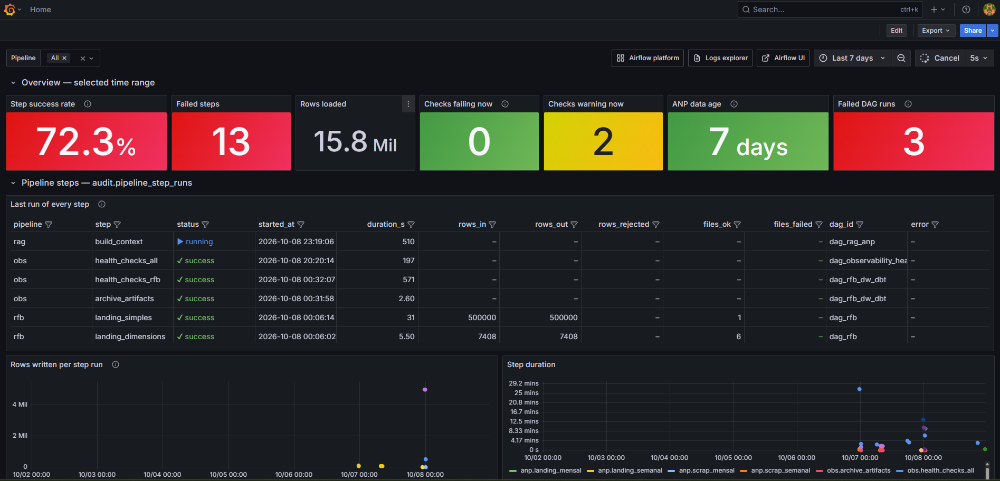
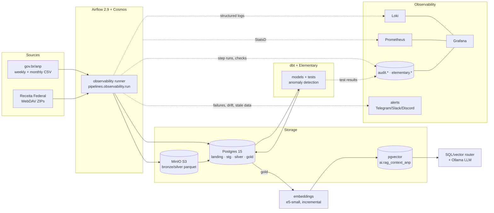

# DataLabs — observable data pipelines, from DW to RAG

[](https://github.com/engrodrigoa/datalabs/actions/workflows/ci.yml)


A production-style data platform that runs on a laptop with one command. It ingests Brazilian public
data (**ANP** fuel prices and **Receita Federal** CNPJ registry), models it with **dbt**, serves it to a
**RAG** assistant on **pgvector**, and makes every step **observable**: structured logs, platform
metrics, per-step volumes, and data health checks, all in Grafana.

> **The question this project answers:** *is the data right, complete and on time, and how would I know if it wasn't?*

<!-- Screenshot: run `make up && make demo`, open Grafana, capture "DataLabs · Pipeline Health" -->


---

## What this project demonstrates

| Area | Evidence in this repo |
|---|---|
| **Observability** | structured logs (readable line + JSON fields) → Loki, Airflow StatsD → Prometheus, per-step audit table, 5 dashboards as code, alerting to Telegram/Slack/Discord |
| **Data quality** | dbt tests + **Elementary anomaly detection** (volume, freshness, column) + config-driven **freshness / volume / reconciliation** checks across layers |
| **Reliability** | idempotent and resumable loads (a re-run skips what already landed), late-arriving data handled, schema-drift detection, honest exit codes (no "green with no data") |
| **AI data engineering** | **incremental embeddings** (deterministic chunk ids, set-difference sync) → pgvector (HNSW), SQL-vs-vector query router, **golden-set evaluation as a quality gate** in the DAG |
| **Performance engineering** | bottlenecks measured, fixed and recorded in ADRs: stateful services on Docker volumes (health checks 7 min → 2 s), Cosmos from a pre-built dbt manifest, RFB read as a stream from the ZIP (~35 s per file instead of extracting multi-GB CSVs at ~3 MB/s) |
| **DataOps** | CI runs lint, unit tests, a real Postgres + dbt build + checks, and executes every Grafana query; pinned images; one-command setup |
| **Data modeling** | medallion layers (landing → staging → silver → gold), star schemas for ANP and RFB, incremental models |

---

## Architecture



---

## Observability, in depth

### Four signals, one place

| Signal | How it is produced | Where it lives | Question it answers |
|---|---|---|---|
| **Logs** | every script logs JSON events (`event=file_loaded`, `schema_drift_missing_columns`, `step_finished`…) with `dag_id/run_id/task_id` attached automatically | Loki (Promtail parses the JSON) | *What happened, exactly?* |
| **Metrics** | Airflow StatsD → `statsd-exporter` (labelled by `dag_id`/`task_id`) | Prometheus | *Is the platform healthy?* scheduler heartbeat, queue, p95 task duration, import errors |
| **Step facts** | the runner wraps every script and records status, duration, rows in/out/rejected, files ok/failed | `audit.pipeline_step_runs` | *How much data moved, and is it normal?* (baseline = median of the last 10 runs) |
| **Data health** | dbt tests + Elementary anomalies at build time; `checks.yml` on a schedule | `elementary.*`, `audit.data_quality_checks` | *Is the data fresh, complete and consistent between layers?* |

### Zero-touch instrumentation

Every task runs its script through one wrapper. The script itself does not change. It can optionally report volumes:

```python
# airflow: observed_script("landing_semanal", "anp", "anp/anp_03_anp_landing_semanal.py")
from pipelines.observability import current_step

step = current_step()
step.add(rows_in=df.height, files_total=len(files))
step.add(rows_out=written)          # -> audit.pipeline_step_runs + step_finished event
```

Exit codes keep their Airflow meaning: `0` success, `99` skipped (*no new data*), anything else failed.

### Data health checks (`pipelines/observability/checks.yml`)

```yaml
- name: anp_silver_to_gold_reconciliation   # did rows get lost between layers?
  type: reconciliation
  query: SELECT COUNT(*) FROM silver.anp_combustivel
  compare_query: SELECT COUNT(*) FROM gold.ft_anp_combustiveis
  tolerance_pct: 0

- name: anp_gold_data_freshness               # is the source still publishing?
  type: freshness
  query: SELECT MAX(data_coleta) FROM gold.ft_anp_combustiveis
  warn_after_hours: 240
  error_after_hours: 408
```

The checks run at the end of every pipeline **and** every 6 hours in `dag_observability_health`, so a source
that silently stops publishing is detected even when no DAG runs. Coverage includes freshness, volume, UF
coverage, invalid prices, orphan facts, stg→silver→gold reconciliation, suspicious RFB rows, duplicate keys,
RAG context parity, RAG accuracy, and stale "running" steps (killed by OOM).

Each check also carries guardrails: `timeout_s` (a slow query ends as `error`, never hangs the DAG),
`cost: heavy` (full scans run after their own pipeline, not in the 6-hourly sweep) and
`suspended: "<reason>"` (temporarily recorded as `skipped` with the reason, visible in Grafana).

### Dashboards (versioned as code: `grafana/dashboards-src/build.py`)

| Dashboard | Content |
|---|---|
| **Pipeline Health** (home) | success rate, failed steps, rows loaded, failing checks, data age · last run of every step · volume vs. baseline · check status · dbt/Elementary test results · slowest models · Airflow DAG runs and task failures · RAG accuracy per evaluation · error logs |
| **Airflow Platform** | scheduler heartbeat, import errors, executor slots, task outcomes, p95 duration per DAG, schedule delay, DAG parse time |
| **Logs Explorer** | filter by DAG / level / event / free text, parsed JSON events and raw logs |
| **ANP (combustíveis)** | data product view: every load (files, rows, duration, slowest tasks) · batch profile per load (rows/price by product, coverage, volume vs. median) · health checks incl. suspended ones · dbt tests · weekly prices by UF (`gold.ag_anp_preco_semanal`) · RAG sync (full/incremental, embedding speed, parity, eval gate) |
| **NF-e (IBS/CBS)** | batches (`ctrl.nfe_lote`), quarantine, dbt/Elementary tests, tax performance of the gold layer |

Grafana reads Postgres through a **read-only role** (`grafana_ro`), and Airflow metadata lives in its own database.

### Alerting

Configure one channel in `.env` (`TELEGRAM_BOT_TOKEN`/`TELEGRAM_CHAT_ID` or `ALERT_WEBHOOK_URL`). Alerts are designed to fire **once, on the root cause**:

* task failure → Airflow callback **after the last retry**
* partial load (some files failed) → runner
* failing / warning data checks → checks
* SLA miss on the ANP DAG
* the final audit task **fails the DAG run** when any task failed (an `ALL_DONE` leaf would otherwise mark the run green), and it does not send an alert of its own

---

## Data products

### ⛽ ANP — fuel prices (`dag_dbt_anp`, weekly)

`scrape (weekly + monthly) → landing (Postgres) → dbt: stg → silver → gold star schema → Elementary → health checks`

* **Late-arriving data:** the monthly closed file arrives weeks later with old survey dates. The incremental fact
  uses the *ingestion* watermark, not the business date, so those rows are not silently dropped.
* **Schema drift:** files are validated against the expected contract. A file with missing columns is rejected (and alerted), and extra columns are dropped with a warning.
* **History preserved:** the weekly file keeps the same name every week, so each load is keyed by survey reference instead of being overwritten.
* Gold: `ft_anp_combustiveis`, `dm_postos`, `dm_produtos`, with tests and Elementary volume/freshness/column anomaly monitors.

### 🏢 RFB — CNPJ open data (`dag_rfb` → `dag_rfb_dw_dbt`)

`WebDAV ZIPs → bronze parquet (MinIO) → silver parquet (typed, audited) → DW landing (COPY) → dbt gold`

* Tens of millions of rows on a single node with Polars + PyArrow batches ([ADR 0002](docs/adr/0002-polars-single-node.md)).
* **CSV read as a stream straight from the ZIP:** nothing is extracted to disk. With `dev_mode` (500k rows per big entity), the reader stops at the limit without decompressing the rest. Extracting a 2.2 GB ZIP to the bind mount ran at ~3 MB/s before reading a single row. Each Estabelecimentos file now loads in about 35 s.
* **Resumable bronze:** a file counts as done only when its parquet exists in MinIO, and the upload happens only after the whole file was read. A re-run continues from the first missing file.
* Shifted-column detection (`_suspeita_deslocamento`) is tracked as a % metric with a threshold.
* **Download driven by a file contract** ([ADR 0009](docs/adr/0009-rfb-source-contract.md)): the source stopped listing its folders and answers intermittently under bursts, so the step fetches the 37 files every month must have, with retries and backoff, accepts a local file only if it is a readable ZIP of the announced size, and names the cause when it fails (link rotated, month not published yet, files that never came). The share link is public configuration (`RFB_SHARE_URL`), so a fresh clone needs no manual step.
* Download → bronze → silver → landing with parallel entities (bounded by `max_active_tasks`), with the `ref_month` parameter set from the UI.
* Dataset-driven scheduling: landing emits `datalabs://landing/rfb`, which triggers the dbt DAG.

### 🧾 NF-e — tax reform DW (IBS/CBS/IS) (`dag_nfe`, sensor-driven)

`simulated issuer → inbox → batch (ctrl) → bronze via SQL (pg_read_file) → dbt: XMLTABLE silver → gold star schema`

* **SQL + dbt only:** ingestion is a PL/pgSQL function and parsing is `XMLTABLE` in dbt. Python only orchestrates and simulates the source system. The XML structure is validated against the official XSDs (IBS/CBS/IS groups, alphanumeric CNPJ).
* **Batch-level control instead of a per-row flag:** the bronze table is insert-only, each batch moves `CARREGADO → PROCESSADO`, and corrected batches are re-queued and merged idempotently ([ADR 0006](docs/adr/0006-nfe-incremental-lotes.md)).
* **SCD2 that survives late-arriving notes:** the participant version key is derived from the note's own attributes, with no date-range join. A `dbt snapshot` is used only where processing time is the right semantics (the cClassTrib reference table).
* **Quality scoped to the batch in flight:** contracts on silver, custom generic tests (access-key and CNPJ check digits, cClassTrib × CST), header × item reconciliation, `store_failures` quarantine in `dq_nfe`, Elementary volume monitor.
* Details: [docs/nfe/README.md](docs/nfe/README.md) · try it: `make nfe-quickstart` (from zero to the `DataLabs · NF-e` dashboard), then `make nfe-stream`.

**Where the data comes from.** There is no public NF-e dataset, so [`scripts/nfe/gen_nfe.py`](scripts/nfe/gen_nfe.py) plays the *source system*: it writes NF-e XMLs (layout 4.00 + IBS/CBS/IS groups, XSD-valid, alphanumeric CNPJ for part of the issuers) into `./datasource/nfe/inbox`, the way documents would reach the tax authority, and `dag_nfe` (FileSensor, every 10 min) picks them up. Everything is synthetic: a stable register of fictitious companies (`--seed-cadastro`), dated register changes that feed the SCD2, and only public codes (IBGE, NCM, CFOP, CST) are real. It needs only the Python standard library, so it runs on the host:

```bash
python scripts/nfe/gen_nfe.py 100                  # 100 notes "from now"
python scripts/nfe/gen_nfe.py 100 --sujo           # + plausible anomalies: business defects 2%, re-sends 1%, truncated files 0.5%
python scripts/nfe/gen_nfe.py 100 --sujo --agora   # + triggers dag_nfe immediately
python scripts/nfe/gen_nfe.py --help               # dates, batches, arrival interval, --manifesto (answer key of injected anomalies)
```

| Make target | Simulates |
|---|---|
| `make nfe-quickstart` | from zero: 2,000 notes Jan–Sep/2026 with anomalies, then triggers the DAG |
| `make nfe-demo` | one arrival of 500 notes |
| `make nfe-stream` | continuous arrival: 12 batches of 200, one every 5 min |
| `make nfe-backfill` | history: 5,000 notes Jan–Sep/2026 |

### 🤖 RAG — fuel price assistant (`dag_rag_anp`, triggered when ANP gold changes)

`gold → semantic chunks (lineage to id_fato) → multilingual-e5 embeddings (incremental by chunk_id) → pgvector HNSW → evaluation gate`

* **Router:** questions with a CNPJ or an aggregation go to exact SQL on gold. Open questions go to vector search. The LLM is told which lines are exact ([ADR 0005](docs/adr/0005-rag-router.md)).
* **Evaluation as a quality gate:** a golden set with SQL ground truth measures routing and value accuracy after every rebuild, and the task **fails below the threshold**. History lives in `ai.rag_eval_*` and is plotted in Grafana.
* **Incremental embeddings** ([ADR 0007](docs/adr/0007-rag-incremental-embeddings.md)): each chunk has a deterministic id (`id_fato:md5(text)`). A run embeds only `gold − store` and deletes `store − gold`, and a run with nothing new exits as *skipped* without loading the model. A full rebuild happens only on an empty store, a model change or an explicit `--full-refresh`.
* **One transaction per sync:** delete/resize, `COPY` and the HNSW build commit together, so a failure rolls back to the previous store. A store that is in sync but missing its index rebuilds only the index.
* **CPU-sized model:** `multilingual-e5-small` (384 dims), one module defines it for writing and querying. A full rebuild of 32,097 chunks takes ~46 min of embedding, 9.6 s of `COPY` and 14 s of HNSW build. The weekly delta takes minutes.
* Interactive assistant (local LLM through Ollama): `python pipelines/rag/anp/rag03_generator.py`.

---

## Measured on the lab (Docker Desktop on Windows, single machine)

| What | Before | After | Fix |
|---|---|---|---|
| ANP health checks | ~7 min, 2 timeouts | 2.0 s | Postgres on a Docker volume ([ADR 0008](docs/adr/0008-stateful-services-in-docker-volumes.md)) |
| stg → silver reconciliation (all bronze) | > 5 min (timeout) | 35 s | same |
| `COPY` of 32k vectors | 336 s | 9.6 s | same |
| DAG parsing with Cosmos | `dbt ls` at parse time, 120 s timeouts (DAGs disappearing) | manifest read, no `dbt` call | `dbt parse` once at init, `LoadMode.DBT_MANIFEST` |
| `dbt deps` | every run, often timing out | once at init | packages on a Docker volume |
| RFB ZIP → bronze, `dev_mode` (25 files, 10M rows) | first file still extracting at ~3 MB/s | 8 min | stream from the ZIP instead of extracting |
| RAG embedding | e5-base, ~6-7 rows/s, hit the 2 h timeout | e5-small ~12 rows/s, incremental | [ADR 0007](docs/adr/0007-rag-incremental-embeddings.md) |

After a wipe ([runbook](docs/runbook-rebuild.md)): `dag_rfb_dw_dbt` in 9 min (5M establishments, landing = gold reconciled), ANP 789,803 rows silver = gold, RAG eval gate 100% routing / 100% value accuracy.

---

## Quickstart

**Requirements:** Docker with Compose v2 · 6 GB of RAM for Docker (8 GB with the AI profile) · ~15 GB of disk · internet (gov.br, PyPI, Docker Hub). GNU make is optional (the raw commands are below). **Windows:** clone inside WSL (`~/datalabs`), not under `/mnt/c`, and size the WSL VM with [docs/wslconfig.example](docs/wslconfig.example).

```bash
git clone https://github.com/engrodrigoa/datalabs.git && cd datalabs
make preflight # creates .env (random passwords, printed once) and checks Docker, memory, DNS/TLS and pinned images
make up        # builds and starts the stack
make demo      # unpauses the DAGs and runs the ANP pipeline with real data
make doctor    # checks the running stack for silent failures (empty bind mounts, missing models)
```

| Service | URL | |
|---|---|---|
| Grafana | http://localhost:3000 | home = *DataLabs · Pipeline Health* |
| Airflow | http://localhost:8080 | DAGs start paused |
| S3 console (Silo, MinIO-compatible) | http://localhost:9091 | |
| Prometheus | http://localhost:9090 | |

**Logins:** `make creds` (read from `.env`). Passwords are generated per machine: if your browser autofills a password saved for `localhost` on another machine, the login fails with the right user name.

> **Changed a dbt model?** Run `make dbt-parse`. The DAGs render from the dbt manifest generated at startup, so a new or renamed model only shows up in Airflow after the manifest is regenerated.
>
> **Rebuild from zero:** `make clean && make up` and follow [docs/runbook-rebuild.md](docs/runbook-rebuild.md). Every table is derived from public sources or generators.

<details>
<summary>Without make</summary>

```bash
cp .env.example .env            # then change the passwords
./scripts/preflight.sh          # bash: WSL, Linux, macOS or Git Bash
docker compose up -d --build
docker compose exec airflow-scheduler airflow dags unpause dag_dbt_anp
docker compose exec airflow-scheduler airflow dags trigger dag_dbt_anp
```
</details>

<details>
<summary>AI profile (RAG) and GPU</summary>

```bash
make up-ai     # image with sentence-transformers (CPU torch) + Ollama on CPU (llama3.2:1b)
make up-gpu    # same, Ollama on an NVIDIA GPU (needs nvidia-container-toolkit)
```
The default stack does **not** require a GPU. Without the AI image, `dag_rag_anp` skips cleanly and the RAG health checks are recorded as *skipped* (`requires: ai`), not as permanent warnings.

To keep the AI profile across restarts without make, put `INSTALL_AI=true` and `COMPOSE_PROFILES=ai` in `.env`.
Download the embedding model at setup time, not inside the first DAG run: `make models`.
The RAG DAGs (embeddings → pgvector → evaluation gates) run without Ollama; the interactive assistant and the LC 214 answer generation (`generate_answers` in `dag_rag_lc214`, ADR 0015) need it. Without Ollama, that task is *skipped*, not failed. Generation on CPU is bound by the prompt size and the cores: on WSL, check `processors` in `%USERPROFILE%\.wslconfig` (4 of 8 cores made the same answer take 130 s instead of 88 s).
</details>

<details>
<summary>Offline demo (no internet)</summary>

```bash
make up && make demo-offline   # synthetic ANP files (real layout) -> landing -> dbt + Elementary -> health checks
```
</details>

<details>
<summary>Fresh machine / troubleshooting (every case below happened on a clean clone)</summary>

`make preflight` detects most of these before `make up`; `make doctor` detects the silent ones afterwards.

| Symptom | Cause | Fix |
|---|---|---|
| `pull access denied for minio/minio, repository does not exist` | the image was deleted from Docker Hub (2026-09-11) | already fixed: the stack uses Silo pinned by digest ([ADR 0004](docs/adr/0004-object-storage.md)); a weekly CI job checks every pinned image |
| pip fails with `SSLEOFError` / `UNEXPECTED_EOF` on `files.pythonhosted.org` during the build | the ISP/router DNS resolves it to a `100.64.0.0/10` address | Docker Desktop → Settings → Docker Engine: add `"dns": ["1.1.1.1", "8.8.8.8"]` at the **top level** of the JSON, *Apply & restart* (no Windows admin needed) |
| `x509: certificate signed by unknown authority` / `self-signed certificate in certificate chain` (Hugging Face, Ollama) | TLS inspection by a corporate proxy/antivirus | use another network, or `make models-export` on a machine with access + `make models-import` here + `HF_HUB_OFFLINE=1`. Do **not** disable TLS verification |
| Docker/host memory at ~97% | the WSL2 VM has no limit and keeps its page cache | [docs/wslconfig.example](docs/wslconfig.example), then `wsl --shutdown` |
| Grafana shows an empty *DataLabs* folder / no logs in Loki after `wsl --shutdown` | containers restarted by their restart policy mounted the bind mounts **empty** | `docker compose up -d --force-recreate grafana promtail prometheus` (`make doctor` detects it); cloning under `~/` avoids it |
| Elementary anomaly tests fail with `relation "none" does not exist` | Elementary tables missing on an empty database | fixed: `airflow-init` creates them; manual refresh: `make elementary` |
| Edited `.env` but nothing changed | `.env` is read when a container is **created** | `docker compose up -d` (recreates the containers whose configuration changed) |
| `dag_rag_anp` skipped | the image was built without the AI layer | `make up-ai` (by design: the RAG layer is opt-in) |
| `airflow-init` exits 1: `password authentication failed for user "datalab"` | the `pg_data` volume was created with another `.env` (new clone in another folder, deleted `.env`): Postgres applies the passwords only when it creates the volume | restore the old `.env`, or, with nothing to keep, `docker compose down -v` and `make up` (`make preflight` warns, `make doctor` confirms) |
| Task log in the UI: `Could not read served logs: 403 FORBIDDEN` (+ a `secret_key` warning) | webserver and scheduler had no shared `AIRFLOW__WEBSERVER__SECRET_KEY`, so each made its own | `make env` adds it (and `AIRFLOW__CORE__FERNET_KEY`) to an existing `.env`, then `docker compose up -d` |

</details>

---

## Repository layout

```text
airflow/dags/                 DAGs (ANP, RFB, RFB dbt, RAG, setup, observability health)
pipelines/
  anp/  rfb/  rag/anp/        ingestion + AI scripts
  commons/                    logger (JSON), env, S3, Postgres COPY, RAG router
  observability/              runner, step tracker, checks (+ checks.yml), alerting, Airflow callbacks
  dbt_projects/               dbt project: staging · silver · gold, Elementary, profiles via env vars
infra/
  postgres/init/              bootstrap (airflow DB, grafana_ro) + idempotent DDL (single source of truth)
  promtail/  prometheus/      log pipeline, StatsD mapping, scrape config
grafana/
  provisioning/               datasources (fixed UIDs) + dashboard provider
  dashboards-src/build.py     dashboards as code  ->  grafana/dashboards/*.json
tests/                        unit tests + dashboard SQL validation
docs/adr/                     architecture decision records
docs/nfe/  docs/runbook-rebuild.md   NF-e design notes · rebuild-from-zero runbook
scripts/                      sample data generator
```

## Testing & CI

`.github/workflows/ci.yml` runs on every push:

1. **lint + unit tests**: ruff, pytest (runner exit codes, checks logic, schema-drift detection, log format parsed with the same regex as Promtail), and dashboards regenerated from code with no diff allowed.
2. **compose**: `docker compose config` for the default, AI and GPU variants.
3. **data integration**: Postgres + pgvector service, bootstrap script, synthetic ANP files landed through the runner, `dbt build` with Elementary, data health checks, assertions on the audit trail, and **every Grafana SQL query executed as `grafana_ro`**.

## Engineering decisions

* [0001 — Observability: three signals + data health](docs/adr/0001-observability-architecture.md)
* [0002 — Polars on a single node instead of Spark](docs/adr/0002-polars-single-node.md)
* [0003 — Promtail now, Grafana Alloy next](docs/adr/0003-promtail-to-alloy.md)
* [0004 — Object storage: from MinIO to Silo](docs/adr/0004-object-storage.md)
* [0005 — RAG over tabular data: SQL first, vectors second](docs/adr/0005-rag-router.md)
* [0006 — NF-e: batch-level control, immutable bronze, SQL-only transformation](docs/adr/0006-nfe-incremental-lotes.md)
* [0007 — RAG: incremental embeddings and a CPU-sized model](docs/adr/0007-rag-incremental-embeddings.md)
* [0008 — Stateful services in Docker volumes, not Windows bind mounts](docs/adr/0008-stateful-services-in-docker-volumes.md)
* [0009 — RFB download driven by a file contract, not by the source's listing](docs/adr/0009-rfb-source-contract.md)
* [0010 — Legislation RAG (LC 214/2025): source contract, structural parser, small-to-big chunks](docs/adr/0010-lc214-legislation-rag-ingestion.md)
* [0011 — LC 214 serving tables: upsert by content hash, a projection of the lake](docs/adr/0011-lc214-serving-load.md)
* [0012 — LC 214 question router: citations by SQL, questions by vectors, both when both](docs/adr/0012-lc214-question-router.md)
* [0013 — LC 214 vector search: exact cosine over an incremental store, context under an LLM budget](docs/adr/0013-lc214-vector-search-and-context.md)
* [0014 — LC 214 retrieval gate: golden set through the real retriever, thresholds from a committed baseline](docs/adr/0014-lc214-retrieval-evaluation-gate.md)
* [0015 — LC 214 answer generation: cited JSON from a local LLM, three barriers to "não consta"](docs/adr/0015-lc214-answer-generation.md)

## Roadmap

**RAG (next focus)**
- [ ] Retrieval quality: hybrid search (Postgres full-text + vectors with reciprocal rank fusion), per-station chunks, a similarity threshold that answers "not in the data"
- [ ] Retrieval metrics in the eval gate (recall@k, MRR), answer-level evaluation (faithfulness), known gaps first: name queries (precision@5 = 0) and out-of-scope questions
- [ ] Unstructured corpus (ANP resolutions, RFB manuals) with document-level chunking and metadata filters

**Platform**
- [ ] Airflow logs on a Docker volume + Grafana Alloy + Loki 3 (Promtail is EOL and polls the bind mount)
- [ ] RFB download that tolerates an unavailable source when the month is already complete on disk
- [ ] OpenLineage → Marquez lineage across Airflow and dbt
- [ ] Data contracts published from dbt (`contract: enforced`) for the gold layer
- [ ] Airflow 3 migration
- [ ] Public read-only demo (Streamlit over a gold snapshot)

**Scale (dedicated server)**
- [ ] Full RFB load with reference history and SCD2 by snapshot diff (row hash per CNPJ, validity from the reference date)

## Author

**Rodrigo Arruda Carneiro**, Data Engineer: from traditional DW to vector databases, focused on observability and data quality through DataOps and CI/CD.
[GitHub](https://github.com/engrodrigoa) · [LinkedIn](https://www.linkedin.com/in/rodrigoarruda89)

<sub>Data sources: ANP — Série histórica de preços de combustíveis; Receita Federal — Dados Abertos do CNPJ. Public data, used for study purposes.</sub>
