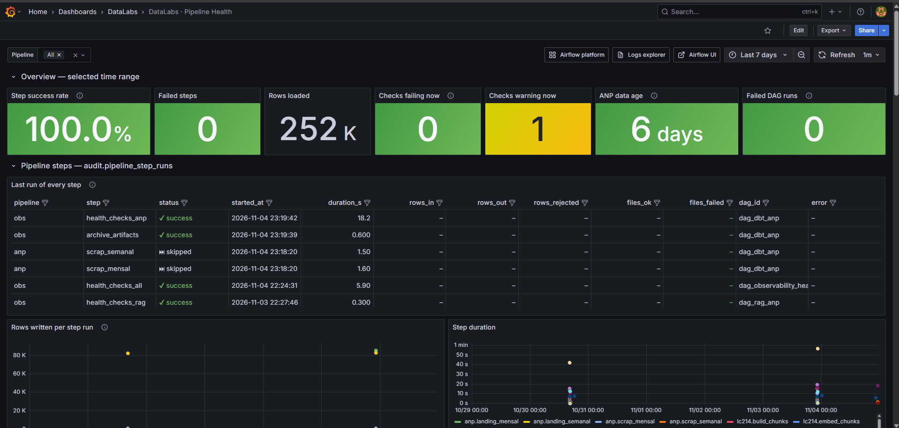
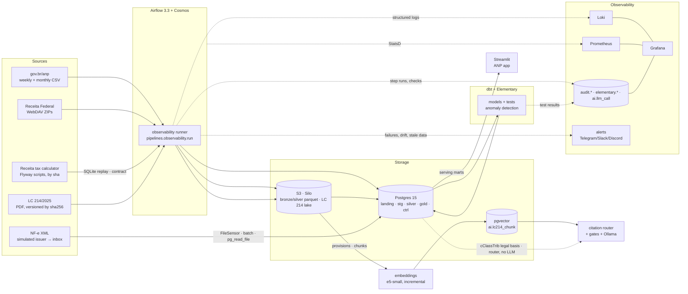

# DataLabs — observable data pipelines, from DW to RAG

[](https://github.com/engrodrigoa/datalabs/actions/workflows/ci.yml)


A production-style data platform that runs on one machine with Docker Compose. Four data products share one
platform (Airflow 3, dbt, Postgres + pgvector, S3) and one observability layer (Loki, Prometheus, an audit trail
and data health checks, all in Grafana).

> **The question this project answers:** *is the data right, complete and on time, and how would I know if it wasn't?*

<!-- Screenshot: run `make up && make demo`, open Grafana, capture "DataLabs · Pipeline Health" -->


---

## The four products

| Product | What it shows | DAG | Run it | Grafana |
|---|---|---|---|---|
| ⛽ **ANP fuel prices** | data engineering on a messy public source: late-arriving files, schema drift, incremental star schema, a serving layer for an app | `dag_dbt_anp` (weekly) | `make demo` | *ANP (combustíveis)* |
| 🏢 **RFB CNPJ registry** | volume on a single node: tens of millions of rows streamed from ZIPs with Polars, a source that cannot be listed | `dag_rfb` → `dag_rfb_dw_dbt` | [trigger `dag_rfb`](#rfb) | *Pipeline Health* |
| 🧾 **NF-e tax reform (IBS/CBS/IS)** | the 2026 tax reform as data: XML in SQL + dbt, batch control, SCD2, fiscal quality rules, quarantine, each item checked against the **official cClassTrib/NCM tables** of the Receita's tax calculator | `dag_nfe` (every 10 min) + `dag_rtc_ref` (daily) | `make nfe-quickstart` + `make rtc-ref` | *NF-e (IBS/CBS)* |
| ⚖️ **RAG over the LC 214/2025** | AI data engineering: the tax reform law as a governed source, a deterministic citation router, retrieval and answer **gates**, token usage per call | `dag_rag_lc214` (weekly) | [AI profile](#lc214) | *RAG LC 214* |

The NF-e and the LC 214 meet on the **cClassTrib** code (the tax classification every NF-e item carries). The
official table gives each code a legal reference (`Art. 412, I`); the LC 214 router reads it, with no LLM, and
**every adherent NF-e item points at the text of the law that grounds its taxation**
([ADR 0021](docs/adr/0021-cclasstrib-lc214-bridge.md)). From those provisions the local LLM writes **why** each
classification has its treatment, citing the law as the source ([ADR 0022](docs/adr/0022-cclasstrib-explanation.md)).

Every product is planned in the same three lanes, and this README describes each one that way:

| Lane | Question |
|---|---|
| **Data** | where does the data come from, and what does each layer add? |
| **Observability** | did the load run, how much moved, and is that normal? |
| **Quality** | is the data right: complete, consistent between layers, inside the business rules? |

---

## How to run

### 1. Requirements

* Docker with Compose v2 · 6 GB of RAM for Docker (**8 GB** with the AI profile) · ~15 GB of disk · internet
  (gov.br, PyPI, Docker Hub; Hugging Face and Ollama for the AI profile).
* GNU make (optional: every target has its raw command, see [without make](#without-make)).
* **Windows:** clone inside WSL (`~/datalabs`), not under `/mnt/c`, and size the WSL VM with
  [docs/wslconfig.example](docs/wslconfig.example) (`scripts/dev-setup-wsl.sh` sets up the WSL Ubuntu side).

### 2. Start the platform

```bash
git clone https://github.com/engrodrigoa/datalabs.git && cd datalabs
make preflight   # creates .env (random passwords) and checks Docker, memory, DNS/TLS and the pinned images
make up          # builds and starts Postgres, S3 (Silo), Airflow 3, Grafana, Loki, Prometheus
make creds       # the logins for THIS machine (passwords are random per machine)
make doctor      # checks the running stack for silent failures (empty bind mounts, missing models)
```

| Service | URL | |
|---|---|---|
| Grafana | http://localhost:3000 | home = *DataLabs · Pipeline Health*; one board per product |
| Airflow | http://localhost:8080 | **DAGs start paused**: the targets below unpause what they need |
| S3 console (Silo) | http://localhost:9091 | buckets `landing` · `bronze` · `silver` · `gold` · `audit` (the LC 214 lake lives under `*/lc214/`) |
| Prometheus | http://localhost:9090 | |

The first `make up` takes a while (image build, `airflow-init` migrates the metadata DB, installs the dbt packages
and generates the dbt manifest). Wait until `docker compose ps` shows `airflow-init` as *Exited (0)*.

### 3. Run a product

Each product runs on its own; pick any of them, in any order.

**⛽ ANP** (real data from gov.br/anp):
```bash
make demo             # unpauses the ANP, setup and health DAGs and runs dag_dbt_anp once
make demo-offline     # no internet: synthetic ANP files (real layout) -> landing -> dbt -> checks
make dashboard-anp    # Streamlit app on http://localhost:8501 (own venv, reads the gold as anp_app_ro)
```

<a id="rfb"></a>**🏢 RFB** (`dev_mode` on by default: 500k rows per big entity; download ~21 min):
```bash
docker compose exec -T airflow-scheduler airflow dags unpause dag_setup_infrastructure
docker compose exec -T airflow-scheduler airflow dags unpause dag_rfb_dw_dbt    # runs on the landing asset
docker compose exec -T airflow-scheduler airflow dags unpause dag_rfb
docker compose exec -T airflow-scheduler airflow dags trigger dag_rfb --conf '{"ref_month": "2026-08"}'
```

**🧾 NF-e** (synthetic notes; nothing real ever enters the repo):
```bash
make nfe-quickstart   # Elementary tables, 2,000 notes Jan–Sep/2026 with anomalies, unpauses + triggers dag_nfe
make nfe-stream       # then: continuous arrival, 12 batches of 200 notes, one every 5 min
make rtc-ref          # official cClassTrib/NCM tables (Receita calculator) -> adherence of every item
make rtc-explain      # AI profile: why each cClassTrib has its treatment, cited from the LC 214 (~3 h the first time)
```

<a id="lc214"></a>**⚖️ RAG LC 214** (needs the AI profile: sentence-transformers on CPU + Ollama with `qwen2.5:3b`):
```bash
./scripts/preflight.sh --ai   # also checks the AI downloads (PyTorch wheels, Hugging Face, Ollama registry)
make up-ai                    # rebuilds the image with the AI layer, starts Ollama and pulls qwen2.5:3b
make models                   # downloads the embedding model now, not inside the first DAG run
docker compose exec -T airflow-scheduler airflow dags unpause dag_rag_lc214
docker compose exec -T airflow-scheduler airflow dags trigger dag_rag_lc214
```
The run downloads the law from the Câmara, parses it, embeds 867 chunks and runs both gates. The answer step is
CPU-bound (~40 min for the 11-phrasing dev subset); on WSL give it every core (`processors` in
`%USERPROFILE%\.wslconfig`). `make up-ai` builds with `INSTALL_AI=true` for that call only: a later `make up` rebuilds
**without** the AI layer. To keep it, set `INSTALL_AI=true` and `COMPOSE_PROFILES=ai` in `.env`.

Without the AI image the LC 214 DAG stops at its AI gate and its checks are recorded as *skipped*
(`requires: ai`), not as warnings: the AI layer is opt-in by design.

### 4. Check the result

```bash
make health   # runs every data health check now (results in Grafana and obs.v_check_last_result)
make urls     # the addresses again
```

| Board (Grafana) | Look for |
|---|---|
| *Pipeline Health* | every step green, rows loaded vs. baseline, failing checks = 0, data age |
| *ANP (combustíveis)* | the last load (files, rows, duration), batch profile, prices by UF |
| *NF-e (IBS/CBS)* | batches `PROCESSADO`, quarantine counts, tax totals of the gold layer |
| *RAG LC 214* | both gates standing (metric above its floor), false answers = 0, tokens per call |

### 5. Stop, rebuild

```bash
make down     # stops everything, keeps the data
make clean    # DELETES every volume (Postgres, S3, models, Grafana...): then make up and docs/runbook-rebuild.md
```
Changed a dbt model? `make dbt-parse`: the DAGs render from the dbt manifest, so a new or renamed model only shows
up in Airflow after the manifest is regenerated. `make help` lists every target.

<details id="without-make">
<summary>Without make (PowerShell or any shell)</summary>

```bash
cp .env.example .env            # then replace every change-me value (passwords and the Airflow keys)
./scripts/preflight.sh          # bash: WSL, Linux, macOS or Git Bash
docker compose up -d --build                                       # make up
$env:INSTALL_AI = "true"; docker compose --profile ai up -d --build  # make up-ai (PowerShell)
docker compose exec -T airflow-scheduler airflow dags unpause dag_dbt_anp
docker compose exec -T airflow-scheduler airflow dags trigger dag_dbt_anp
```
The [runbook](docs/runbook-rebuild.md) has every step in this form. `make env` is the safe way to create `.env`:
it generates the three Airflow keys, which compose refuses to start without.
</details>

<details>
<summary>GPU (optional)</summary>

```bash
make up-gpu    # the AI profile with Ollama on an NVIDIA GPU (needs nvidia-container-toolkit)
```
The default stack needs no GPU.
</details>

<details>
<summary>Fresh machine / troubleshooting (every case below happened on a clean clone)</summary>

`make preflight` detects most of these before `make up`; `make doctor` detects the silent ones afterwards.

| Symptom | Cause | Fix |
|---|---|---|
| `pull access denied for minio/minio, repository does not exist` | the image was deleted from Docker Hub (2026-09-11) | already fixed: the stack uses Silo pinned by digest ([ADR 0004](docs/adr/0004-object-storage.md)); a weekly CI job checks every pinned image |
| pip fails with `SSLEOFError` / `UNEXPECTED_EOF` on `files.pythonhosted.org` during the build | the ISP/router DNS resolves it to a `100.64.0.0/10` address | Docker Desktop → Settings → Docker Engine: add `"dns": ["1.1.1.1", "8.8.8.8"]` at the **top level** of the JSON, *Apply & restart* (no Windows admin needed) |
| `x509: certificate signed by unknown authority` / `self-signed certificate in certificate chain` (Hugging Face, Ollama) | TLS inspection by a corporate proxy/antivirus | use another network, or `make models-export` on a machine with access + `make models-import` here + `HF_HUB_OFFLINE=1`. Do **not** disable TLS verification |
| Docker/host memory at ~97% | the WSL2 VM has no limit and keeps its page cache | [docs/wslconfig.example](docs/wslconfig.example), then `wsl --shutdown` |
| Grafana shows an empty *DataLabs* folder / no logs in Loki after `wsl --shutdown` | containers restarted by their restart policy mounted the bind mounts **empty** | `docker compose up -d --force-recreate grafana promtail prometheus` (`make doctor` detects it); cloning under `~/` avoids it |
| Elementary anomaly tests fail with `relation "none" does not exist` | Elementary tables missing on an empty database | fixed: `airflow-init` creates them; manual refresh: `make elementary` |
| Edited `.env` but nothing changed | `.env` is read when a container is **created** | `docker compose up -d` (recreates the containers whose configuration changed) |
| `dag_rag_lc214` tasks skipped | the image was built without the AI layer (or a later `make up` rebuilt it without) | `make up-ai`, and `INSTALL_AI=true` + `COMPOSE_PROFILES=ai` in `.env` to keep it |
| `airflow-init` exits 1: `password authentication failed for user "datalab"` | the `pg_data` volume was created with another `.env` (new clone in another folder, deleted `.env`): Postgres applies the passwords only when it creates the volume | restore the old `.env`, or, with nothing to keep, `docker compose down -v` and `make up` (`make preflight` warns, `make doctor` confirms) |
| Task log in the UI: `Could not read served logs: 403 FORBIDDEN` (+ a `secret_key` warning) | the Airflow containers had no shared `AIRFLOW__API__SECRET_KEY`, so each made its own | `make env` adds it to an existing `.env`, then `docker compose up -d` |
| Every task fails at start with `403` / `Invalid auth token` from the Execution API | no shared `AIRFLOW__API_AUTH__JWT_SECRET` (an Airflow 2 `.env`): compose stops with `missing in .env, run make env` | `make env` generates the Airflow 3 keys into the existing `.env`, then `docker compose up -d` ([ADR 0017](docs/adr/0017-airflow-3-migration.md)) |
| Upgrading an Airflow 2.9 install | the metadata DB in `pg_data` is from 2.9; the old `airflow_webserver` container still holds port 8080 | `make down` first (removes the orphaned webserver), then `sudo rm -rf airflow/logs/dag_id=* airflow/logs/scheduler` (Airflow 2 logs, written by the container user), then `make env && make up`. Nothing to drop: `airflow-init` migrates the DB in place, run history included. A run left *running* by the old stack blocks DAGs with `max_active_runs=1` (e.g. `dag_nfe`): mark it failed in the UI |
| AI build fails: `ResolutionImpossible`, `sentence-transformers ... depends on numpy<2.0.0` | pip blames numpy while backtracking; the real conflict is `tokenizers` pinned by the Airflow image vs. transformers 4.x | already fixed: `sentence-transformers>=5` (ADR 0017, decision 9); the CI dry-runs the AI layer against the Airflow constraints |
| `make up`: `Bind for 0.0.0.0:8080 failed: port is already allocated` | the Airflow 2 `airflow_webserver` container is still running (no longer in the compose file, so `up` does not touch it) | `make down` (it runs `down --remove-orphans`), then `make up` |
| `dag_rag_anp` still listed in Airflow after updating | the ANP RAG was retired ([ADR 0020](docs/adr/0020-retire-anp-rag.md)); its file is gone but its run history is not | `docker compose exec -T airflow-scheduler airflow dags delete dag_rag_anp -y` (once); its tables and audit rows are cleaned by `dag_setup_infrastructure` / `make db-bootstrap` |

</details>

---

## Architecture



---

## Data products

### ⛽ ANP — fuel prices (`dag_dbt_anp`, Mondays 06:00)

| Lane | |
|---|---|
| **Data** | scrape (weekly + monthly files) → landing (Postgres) → dbt: stg → silver → gold star schema (`ft_anp_combustiveis`, `dm_postos`, `dm_produtos`) → two serving marts → Streamlit app |
| **Observability** | every load in `audit.pipeline_step_runs` (files, rows, duration), Loki events (`file_loaded`, `schema_drift_*`), a 3 h run deadline, board *ANP (combustíveis)* with the batch profile of each load |
| **Quality** | dbt tests + Elementary (volume, freshness, column anomalies); 8 health checks: freshness of source and gold, load volume, UF coverage, invalid prices, stg → silver → gold reconciliation, orphan facts; the marts are reconciled with the fact by tests |

* **Late-arriving data:** the monthly closed file arrives weeks later with old survey dates. The incremental fact
  uses the *ingestion* watermark, not the business date, so those rows are not silently dropped.
* **Schema drift:** files are validated against the expected contract. A file with missing columns is rejected (and
  alerted), and extra columns are dropped with a warning.
* **History preserved:** the weekly file keeps the same name every week, so each load is keyed by survey reference
  instead of being overwritten.
* **Serving layer** ([ADR 0016](docs/adr/0016-anp-streamlit-analytics-layer.md)): `ag_anp_preco_posto_atual` (latest
  price per station × product) and `ag_anp_preco_municipio_diario` (day × city × product, exact roll-ups). The
  Streamlit app (UF → city → bairro → station, product cards, price line) reads only those two marts, as the
  read-only role `anp_app_ro`.

### 🏢 RFB — CNPJ open data (`dag_rfb` → `dag_rfb_dw_dbt`, manual)

| Lane | |
|---|---|
| **Data** | WebDAV ZIPs (a fixed contract of 37 files per month) → bronze parquet (S3) → silver parquet (typed, audited) → DW landing (`COPY`) → dbt gold (`ft_receita_federal` + dimensions) |
| **Observability** | one step per entity and file with bytes, rows and the failure cause by name (link rotated, month not published, file missing); landing emits the asset `datalabs://landing/rfb`, which triggers the dbt DAG |
| **Quality** | 4 health checks (reference freshness, shifted-column rows %, duplicated keys, landing → gold reconciliation), the heavy ones run after the load, not every 6 h; dbt tests on the gold |

* Tens of millions of rows on a single node with Polars + PyArrow batches ([ADR 0002](docs/adr/0002-polars-single-node.md)).
* **CSV read as a stream straight from the ZIP:** nothing is extracted to disk. With `dev_mode` (500k rows per big
  entity), the reader stops at the limit without decompressing the rest. Each Estabelecimentos file loads in ~35 s
  (extracting a 2.2 GB ZIP to the bind mount ran at ~3 MB/s before reading a single row).
* **Resumable bronze:** a file counts as done only when its parquet exists in S3, uploaded after the whole file was
  read. A re-run continues from the first missing file.
* **Download driven by a file contract** ([ADR 0009](docs/adr/0009-rfb-source-contract.md)): the source stopped
  listing its folders and answers intermittently under bursts, so the step fetches the files every month must have,
  with retries and backoff, and accepts a local file only if it is a readable ZIP of the announced size.

### 🧾 NF-e — tax reform DW, IBS/CBS/IS (`dag_nfe`, FileSensor every 10 min)

| Lane | |
|---|---|
| **Data** | simulated issuer (`gen_nfe.py`) → inbox → batch (`ctrl.nfe_lote`) → bronze via SQL (`pg_read_file`, insert-only) → dbt: `XMLTABLE` silver → participant SCD2 → gold star schema (`ft_nfe_item`, `ft_nfe_documento`, `ag_nfe_ibscbs_mensal`). Reference: the Receita's Flyway scripts (`ReceitaFederal/calculadora-rtc-regime-regular`) replayed in SQLite → `ref_rtc` → `silver.rtc_*` → `dm_nfe_tributacao` + `ft_nfe_item_aderencia_rtc` (`dag_rtc_ref`) → legal basis: `FDLG_TEXTO_CURTO` → LC 214 router → `ai.rtc_lc214_fundamento` → `gold.br_cclasstrib_lc214` / `vw_nfe_item_fundamento_lc214` → explanation: provisions + table facts → local LLM → `ai.rtc_cclasstrib_explicacao` (`dag_rtc_explain`, AI profile) |
| **Observability** | each batch moves `CARREGADO → PROCESSADO`, rejected files are rows in `ctrl.nfe_arquivo_rejeitado`; each official table version is a row in `ctrl.rtc_carga` (sha, release, contract), a run with the same sha exits *skipped*; board *NF-e (IBS/CBS)* |
| **Quality** | contracts on silver; custom tests (access-key and CNPJ check digits, cClassTrib × CST, header × item reconciliation of IBS/CBS bases and totals, the 2026 IBS/CBS base rule: vProd − ICMS − PIS − COFINS); business anomalies as `warn` + `store_failures` quarantine in `dq_nfe`; Elementary volume monitor; all scoped to the batch in flight. **Adherence to the official table**, one status per item: cClassTrib inexistent, out of validity, CST incompatible, NCM ineligible for the benefit, reduction % different from the official one; 5 `rtc_*` checks. **Legal basis**: citation resolved to one provision, cited provision still in force, Receita's transcription × law text; 4 `rtc_lc214_*` checks. **Explanation**: cites what it read, cites the bridge's provision, no rate without a source; 10 golden cases + human review, gate vs. a committed baseline; 2 `rtc_explain_*` checks |

* **SQL + dbt only:** ingestion is a PL/pgSQL function and parsing is `XMLTABLE` in dbt. Python only orchestrates and
  simulates the source system. The XML is validated against the official XSDs (IBS/CBS/IS groups, alphanumeric CNPJ).
* **Batch-level control instead of a per-row flag:** corrected batches are re-queued and merged idempotently
  ([ADR 0006](docs/adr/0006-nfe-incremental-lotes.md)).
* **SCD2 that survives late-arriving notes:** the participant version key comes from the note's own attributes, with
  no date-range join.
* **Official reference, versioned** ([ADR 0019](docs/adr/0019-rtc-official-reference-tables.md)): the Receita
  publishes the tables as Flyway scripts; `rtc01` replays them in SQLite (no Java) and checks a structural contract,
  `rtc02` loads them in one transaction. The adherence join is point in time (validity on the issue date). Measured on
  7,000 synthetic notes: 64/64 ineligible NCM, 63/63 incoherent cClassTrib, 27/27 divergent reductions, 0 false
  positives (the generator's injected defects are the answer key).
* **Legal basis of each item** ([ADR 0021](docs/adr/0021-cclasstrib-lc214-bridge.md)): `rtc03_lc214` reads the
  official reference ("Art. 146, § 1º, I e II") with the LC 214 router and resolves it against the law served:
  one row per citation, outcome named (resolved, ambiguous, not found), status of the provision, and the Receita's
  transcription compared with the law's text. It runs when either side changes: a new official version (daily) or
  a new law version (asset `datalabs://serving/lc214`). Measured on the official table 1.7.2: 238 citations from
  202 references, **236 linked to one provision (100%)**, 0 revoked, 3 transcriptions that differ from the law's
  text. One reference is ambiguous *in the source* ("Art. 80 II": two §§ have an inciso II); the Receita's own
  transcription quotes one of them, so the bridge links it as `resolved_by_text` and keeps both candidates.
* **Why each classification has its treatment** ([ADR 0022](docs/adr/0022-cclasstrib-explanation.md)): `rtc04_explain`
  gives the local LLM (qwen2.5:3b) the articles the bridge linked plus the table's facts, and keeps the LC 214
  generator's barriers: an explanation is shown only when it cites a provision it was shown, with the law as the
  source (`fontes`). No vector search: the context is decided by data, so the auditor-vocabulary gap of the RAG does
  not apply. Per row it checks that the citation falls on the bridge's provision and that every percentage stated is
  in the table or the law. Incremental by a fingerprint per row (prompt, model digest), resumable in 80-min runs
  (`dag_rtc_explain`, on the asset `datalabs://gold/rtc`). 202 classifications: 200 with a provision, 2 "Regra Geral"
  with a fixed text; context p50 439 tokens, max 1,938.
* **Where the data comes from:** there is no public NF-e dataset, so
  [`scripts/nfe/gen_nfe.py`](scripts/nfe/gen_nfe.py) plays the *source system*: XSD-valid notes with a stable register
  of fictitious companies, dated register changes for the SCD2 and plausible anomalies on demand. Only public codes
  (IBGE, NCM, CFOP, CST) are real. Details: [docs/nfe/README.md](docs/nfe/README.md) (pt-BR).

| Make target | Simulates |
|---|---|
| `make nfe-quickstart` | from zero: 2,000 notes Jan–Sep/2026 with anomalies, then triggers the DAG |
| `make nfe-demo` | one arrival of 500 notes |
| `make nfe-stream` | continuous arrival: 12 batches of 200, one every 5 min |
| `make nfe-backfill` | history: 5,000 notes Jan–Sep/2026 |

The generator needs only the Python standard library, so it also runs on the host:
`python scripts/nfe/gen_nfe.py 100 --sujo --agora` (100 notes with anomalies, triggers `dag_nfe`; `--help` for the rest).

### ⚖️ RAG — LC 214/2025, the tax reform law (`dag_rag_lc214`, Mondays 06:40)

An auditor's question is answered from the law or refused, and every refusal names the barrier that decided it. The
design starts from *when not to answer*: **false answers have a ceiling of 0**, refusals of answerable questions are
measured as the cost.

| Lane | |
|---|---|
| **Data** | PDF from the Câmara, versioned by sha256 (lc01) → one row per provision, ids from the printed labels (lc02) → small-to-big chunks under the 512-token limit (lc03) → `ai.lc214_dispositivo` / `ai.lc214_artigo` by upsert (lc04a) and `ai.lc214_chunk` by set difference (lc04c) → router → retriever → `qwen2.5:3b` → cited JSON (lc06) |
| **Observability** | each step exits *skipped* when its input and code version are unchanged; the gates record the floor they judged against; every LLM call is a row in `ai.llm_call` (tokens reported by the model, the estimate next to it, prompt as a hash); board *RAG LC 214* |
| **Quality** | source contract (pages, sha256); parser invariants with known source defects listed in code; golden contract (routing 87/87 phrasings, 1,350 of the law's 1,352 self-citations resolved); 10 health checks (serving and vector parity, single law version, LLM usage); **retrieval gate** (lc05) and **answer gate** (lc06) against committed baselines |

| | measured (2026-10) |
|---|---|
| corpus | 4,223 provisions, 867 chunks (0 over the 512-token limit), golden contract 87/87 phrasings |
| retrieval gate (lc05) | fiscal / formal success@k 0.39 / 0.48, context recall 0.65 / 0.77; fiscal × formal gap 0.16 |
| answers (lc06, dev subset of 11 phrasings) | llama3.2:1b 0/9 (invented a calculation), **qwen2.5:3b 2/9, 0 invented**; acceptance bar was 3/9 and is **not met** |
| reproducibility | last DAG run: 0 verdict flips, 0/11 texts reworded against the baseline |

* **Router before retrieval** ([ADR 0012](docs/adr/0012-lc214-question-router.md)): a citation goes to SQL (exact
  text, status), a citation + question is *combined* (the cited provision anchors the context), a question goes to
  vectors, and an ambiguous citation is asked back, never guessed. It reads lists and ranges ("I, II e XIII",
  "I a XVIII", "§§ 3º e 4º", "incisos I e II do caput"), the form the official cClassTrib table cites the law in:
  the law's own self-citations it reads went from 799 to 1,352 (ADR 0021).
* **Two gates, one rule** ([ADR 0014](docs/adr/0014-lc214-retrieval-evaluation-gate.md),
  [ADR 0015](docs/adr/0015-lc214-answer-generation.md)): thresholds are a committed baseline minus a tolerance **in
  cases**; improvements never fail, raising the baseline is a deliberate commit, a missing baseline fails the run.
* **Three barriers to "não consta":** nothing to ground on (no LLM call), the model's own `answerable`, and a citation
  check against the provisions the context actually showed (valid | outside_context | not_found | foreign).
* **What failed, in the open:** the small model refuses fiscal phrasings with "o contexto não trata
  especificamente": the auditor's vocabulary against the law's (ADR 0015, "Where it stands").
* **Tokens per prompt** ([ADR 0018](docs/adr/0018-llm-usage-per-call.md)): four checks watch them: lost writes, calls
  without the model's count, prompts truncated at `num_ctx`, and the drift of the estimate the retriever budgets with.
* Study guide, step by step with the metric and the failure mode of each step:
  [case study (pt-BR)](docs/case-study/lc214-rag.md).

---

## Observability, in depth

### Four signals, one place

| Signal | How it is produced | Where it lives | Question it answers |
|---|---|---|---|
| **Logs** | every script logs a readable line with a JSON tail (`event=file_loaded`, `schema_drift_missing_columns`, `step_finished`…), with `dag_id/run_id/task_id` attached automatically; Airflow 3 wraps each task log line in its own JSON envelope | Loki (Promtail unpacks Airflow's envelope, then parses our line into `level`/`event`/`pipeline` labels) | *What happened, exactly?* |
| **Metrics** | Airflow StatsD → `statsd-exporter` (labelled by `dag_id`/`task_id`) | Prometheus | *Is the platform healthy?* scheduler heartbeat, queue, p95 task duration, import errors |
| **Step facts** | the runner wraps every script and records status, duration, rows in/out/rejected, files ok/failed | `audit.pipeline_step_runs` | *How much data moved, and is it normal?* (baseline = median of the last 10 runs) |
| **Data health** | dbt tests + Elementary anomalies at build time; `checks.yml` on a schedule | `elementary.*`, `audit.data_quality_checks` | *Is the data fresh, complete and consistent between layers?* |

### Zero-touch instrumentation

Every task runs its script through one wrapper. The script itself does not change. It can optionally report volumes:

```python
# airflow: observed_script("landing_semanal", "anp", "anp/anp_03_anp_landing_semanal.py")
from pipelines.observability import current_step

step = current_step()
step.add(rows_in=df.height, files_total=len(files))
step.add(rows_out=written)          # -> audit.pipeline_step_runs + step_finished event
```

Exit codes keep their Airflow meaning: `0` success, `99` skipped (*no new data*), anything else failed.

### Data health checks (`pipelines/observability/checks.yml`)

```yaml
- name: anp_silver_to_gold_reconciliation   # did rows get lost between layers?
  type: reconciliation
  query: SELECT COUNT(*) FROM silver.anp_combustivel
  compare_query: SELECT COUNT(*) FROM gold.ft_anp_combustiveis
  tolerance_pct: 0

- name: anp_gold_data_freshness               # is the source still publishing?
  type: freshness
  query: SELECT MAX(data_coleta) FROM gold.ft_anp_combustiveis
  warn_after_hours: 240
  error_after_hours: 408
```

34 checks run at the end of every pipeline **and** every 6 hours in `dag_observability_health`, so a source that
silently stops publishing is detected even when no DAG runs. Each check carries guardrails: `timeout_s` (a slow query
ends as `error`, never hangs the DAG), `cost: heavy` (full scans run after their own pipeline, not in the 6-hourly
sweep) and `suspended: "<reason>"` (recorded as `skipped` with the reason, visible in Grafana).

### Dashboards (versioned as code: `grafana/dashboards-src/build.py`)

| Dashboard | Content |
|---|---|
| **Pipeline Health** (home) | success rate, failed steps, rows loaded, failing checks, data age · last run of every step · volume vs. baseline · check status · dbt/Elementary test results · slowest models · Airflow DAG runs and task failures · error logs |
| **Airflow Platform** | scheduler heartbeat, import errors, executor slots, task outcomes, p95 duration per DAG, schedule delay, DAG parse time |
| **Logs Explorer** | filter by DAG / level / event / free text, parsed JSON events and raw logs |
| **ANP (combustíveis)** | every load (files, rows, duration, slowest tasks) · batch profile per load · health checks incl. suspended ones · dbt tests · weekly prices by UF |
| **NF-e (IBS/CBS)** | batches (`ctrl.nfe_lote`), quarantine, dbt/Elementary tests, tax performance of the gold layer, legal basis (references resolved, cited provisions revoked, transcription × law) |
| **RAG LC 214** | is the gate standing? lc05 retrieval and lc06 answer gates (metric × floor, minimum margin), false answers (ceiling 0), data contract per step, health checks, verdict/text drift, latency, tokens per call |

Grafana reads Postgres through a **read-only role** (`grafana_ro`), and Airflow metadata lives in its own database.

### Alerting

Configure one channel in `.env` (`TELEGRAM_BOT_TOKEN`/`TELEGRAM_CHAT_ID` or `ALERT_WEBHOOK_URL`). Alerts are designed
to fire **once, on the root cause**:

* task failure → Airflow callback **after the last retry**
* partial load (some files failed) → runner
* failing / warning data checks → checks
* missed run deadline on the ANP DAG (3 h from queue; Airflow 3 `DeadlineAlert`, which replaced SLAs,
  [ADR 0017](docs/adr/0017-airflow-3-migration.md))
* the final audit task **fails the DAG run** when any task failed (an `ALL_DONE` leaf would otherwise mark the run
  green), and it does not send an alert of its own

---

## Measured on the lab (Docker Desktop on Windows, single machine)

| What | Before | After | Fix |
|---|---|---|---|
| ANP health checks | ~7 min, 2 timeouts | 2.0 s | Postgres on a Docker volume ([ADR 0008](docs/adr/0008-stateful-services-in-docker-volumes.md)) |
| stg → silver reconciliation (all bronze) | > 5 min (timeout) | 35 s | same |
| DAG parsing with Cosmos | `dbt ls` at parse time, 120 s timeouts (DAGs disappearing) | manifest read, no `dbt` call | `dbt parse` once at init, `LoadMode.DBT_MANIFEST` |
| `dbt deps` | every run, often timing out | once at init | packages on a Docker volume |
| RFB ZIP → bronze, `dev_mode` (25 files, 10M rows) | first file still extracting at ~3 MB/s | 8 min | stream from the ZIP instead of extracting |
| LC 214 answers on CPU (WSL) | 130 s per answer with 4 of 8 cores | 88 s with 8 | `processors` in `.wslconfig` ([ADR 0015](docs/adr/0015-lc214-answer-generation.md)) |

After a wipe ([runbook](docs/runbook-rebuild.md)): `dag_rfb_dw_dbt` in 9 min (5M establishments, landing = gold
reconciled), ANP 789,803 rows silver = gold.

---

## Testing & CI

`.github/workflows/ci.yml` runs on every push to `master` and on every pull request:

1. **lint + unit tests**: ruff (incl. `AIR3`, the Airflow 3 migration rules); pytest: runner exit codes, checks
   logic, schema-drift detection, log format parsed with the same regex as Promtail, the LC 214 parser, router,
   retriever and gates on fixtures (no LLM in CI), and the Airflow 3 guardrails; dashboards regenerated from code with
   no diff allowed.
2. **compose**: `docker compose config` for the default, AI and GPU variants.
3. **airflow-dags**: Airflow 3.3.2 with the official constraints parses `airflow/dags` with the dag-processor's
   DagBag: no import errors or deprecated APIs, observability callbacks on every task, the ANP deadline, the asset
   wiring, and the run timestamp rendered with and without a logical date. It also dry-runs the AI layer (CPU torch +
   sentence-transformers) against the same constraints.
4. **data integration**: Postgres + pgvector service, bootstrap script, synthetic ANP files landed through the runner,
   `dbt build` with Elementary, data health checks, assertions on the audit trail, **every Grafana SQL query executed
   as `grafana_ro`**, and the ANP app's queries executed as `anp_app_ro` (which must be denied the fact).

`.github/workflows/image-availability.yml` checks every Monday that each pinned image still exists in its registry
(MinIO's disappearance is why, [ADR 0004](docs/adr/0004-object-storage.md)).

---

## Repository layout

```text
airflow/dags/                 DAGs: ANP, RFB, RFB dbt, NF-e, RTC reference, RAG LC 214, setup, observability health
apps/anp_dashboard/           Streamlit app over the ANP serving marts (own venv: make dashboard-anp)
pipelines/
  anp/  rfb/                  ingestion scripts
  rtc/                        official cClassTrib/NCM tables: Flyway replay in SQLite, load into ref_rtc
  rag/lc214/                  legislation RAG: parser, chunks, embeddings, router, retriever, gates, generation
  commons/                    logger, env, S3, Postgres COPY, audit trail; ai/: embeddings, sync plan, LLM usage
  observability/              runner, step tracker, checks (+ checks.yml), alerting, Airflow callbacks, DAG helpers
  dbt_projects/               dbt project: staging · silver · gold (tags anp, rfb, nfe, rtc), Elementary
infra/
  postgres/init/              bootstrap (airflow DB, grafana_ro, anp_app_ro) + idempotent DDL (single source of truth)
  promtail/  prometheus/      log pipeline, StatsD mapping, scrape config
grafana/
  provisioning/               datasources (fixed UIDs) + dashboard provider
  dashboards-src/build.py     dashboards as code  ->  grafana/dashboards/*.json
tests/                        unit tests, Airflow 3 guardrails, DAG integrity, dashboard SQL validation
docs/adr/                     architecture decision records
docs/case-study/  docs/nfe/   LC 214 RAG study guide (pt-BR) · NF-e design notes (pt-BR)
docs/runbook-rebuild.md       rebuild-from-zero runbook
scripts/                      preflight, doctor, NF-e source simulator, ANP sample data, WSL setup
```

## Engineering decisions

| | Platform | | Products |
|---|---|---|---|
| [0001](docs/adr/0001-observability-architecture.md) | Observability: three signals + data health | [0006](docs/adr/0006-nfe-incremental-lotes.md) | NF-e: batch-level control, immutable bronze, SQL-only transformation |
| [0002](docs/adr/0002-polars-single-node.md) | Polars on a single node instead of Spark | [0009](docs/adr/0009-rfb-source-contract.md) | RFB download driven by a file contract, not by the source's listing |
| [0003](docs/adr/0003-promtail-to-alloy.md) | Promtail now, Grafana Alloy next | [0010](docs/adr/0010-lc214-legislation-rag-ingestion.md) | LC 214: source contract, structural parser, small-to-big chunks |
| [0004](docs/adr/0004-object-storage.md) | Object storage: from MinIO to Silo | [0011](docs/adr/0011-lc214-serving-load.md) | LC 214 serving tables: upsert by content hash |
| [0008](docs/adr/0008-stateful-services-in-docker-volumes.md) | Stateful services in Docker volumes, not bind mounts | [0012](docs/adr/0012-lc214-question-router.md) | LC 214 router: citations by SQL, questions by vectors, both when both |
| [0017](docs/adr/0017-airflow-3-migration.md) | Airflow 3: Execution API, deadlines instead of SLAs | [0013](docs/adr/0013-lc214-vector-search-and-context.md) | LC 214 vector search and context under an LLM budget |
| [0018](docs/adr/0018-llm-usage-per-call.md) | LLM usage per call: tokens as the model reported them | [0014](docs/adr/0014-lc214-retrieval-evaluation-gate.md) | LC 214 retrieval gate: golden set, committed baseline |
| [0020](docs/adr/0020-retire-anp-rag.md) | Retire the ANP RAG: one AI product, the LC 214 | [0015](docs/adr/0015-lc214-answer-generation.md) | LC 214 answers: cited JSON, three barriers to "não consta" |
| | | [0016](docs/adr/0016-anp-streamlit-analytics-layer.md) | ANP analytics layer: two serving marts, read-only role |
| | | [0019](docs/adr/0019-rtc-official-reference-tables.md) | Official cClassTrib/NCM tables (Receita calculator) and NF-e adherence |
| | | [0021](docs/adr/0021-cclasstrib-lc214-bridge.md) | NF-e × LC 214: each cClassTrib's legal reference resolved into provisions |
| | | [0022](docs/adr/0022-cclasstrib-explanation.md) | Why each cClassTrib has its treatment: cited explanation from the bridge's provisions |

Superseded, kept as history: [0005](docs/adr/0005-rag-router.md) (RAG over tabular data: SQL first, vectors second)
and [0007](docs/adr/0007-rag-incremental-embeddings.md) (incremental embeddings), both by 0020.

<a id="roadmap"></a>

## Roadmap

**AI: the LC 214 RAG (focus)**
- [x] NF-e × LC 214 bridge: each official cClassTrib's legal reference resolved into provisions by the router, no LLM ([ADR 0021](docs/adr/0021-cclasstrib-lc214-bridge.md))
- [x] Why each cClassTrib has its treatment: the local LLM explains it from the bridge's provisions, citing the law ([ADR 0022](docs/adr/0022-cclasstrib-explanation.md))
- [ ] Explanation baseline from the first full lab run (`rtc04_explain --write-baseline`); NF-e item → explanation join in dbt
- [ ] Answer generation to its acceptance bar (2/9 → 3/9 measured, ADR 0015): fiscal → legal glossary, labelled context lines, full golden run on the lambda server
- [ ] Retrieval quality: hybrid search (Postgres full-text + vectors with reciprocal rank fusion) against the fiscal vocabulary gap, a similarity threshold that answers "not in the law"
- [ ] Answer-level evaluation (faithfulness) next to the citation check

**Platform**
- [ ] Airflow logs on a Docker volume + Grafana Alloy + Loki 3 (Promtail is EOL and polls the bind mount)
- [ ] RFB download that tolerates an unavailable source when the month is already complete on disk
- [ ] OpenLineage → Marquez lineage across Airflow and dbt
- [ ] Data contracts published from dbt (`contract: enforced`) for the gold layer
- [x] Airflow 3 migration: 3.3.2, in place, history kept ([ADR 0017](docs/adr/0017-airflow-3-migration.md))
- [ ] Public read-only demo (Streamlit over a gold snapshot)

**Scale (dedicated server)**
- [ ] Full RFB load with reference history and SCD2 by snapshot diff (row hash per CNPJ, validity from the reference date)

## Author

**Rodrigo Arruda Carneiro**, Data Engineer: from traditional DW to vector databases, focused on observability and data
quality through DataOps and CI/CD.
[GitHub](https://github.com/engrodrigoa) · [LinkedIn](https://www.linkedin.com/in/rodrigoarruda89)

<sub>Data sources: ANP — Série histórica de preços de combustíveis; Receita Federal — Dados Abertos do CNPJ; Câmara dos
Deputados — LC 214/2025 (norma atualizada). Public data, used for study purposes. NF-e data is synthetic.</sub>
